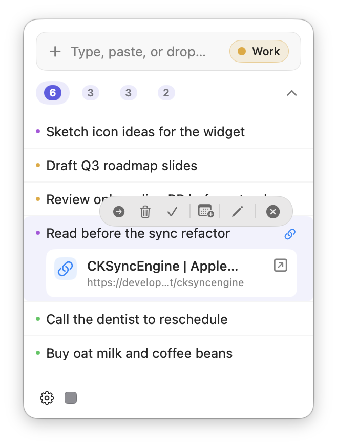
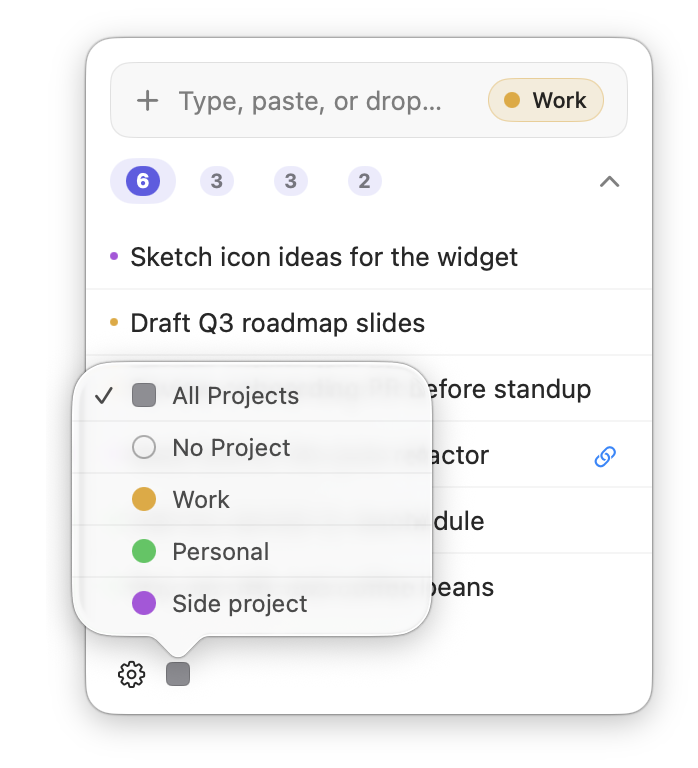
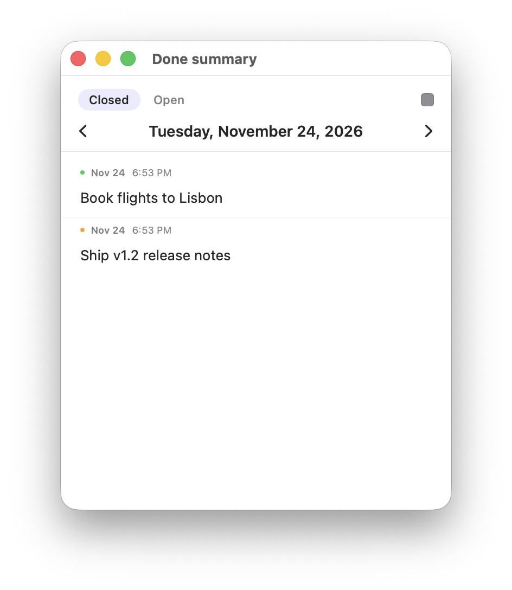
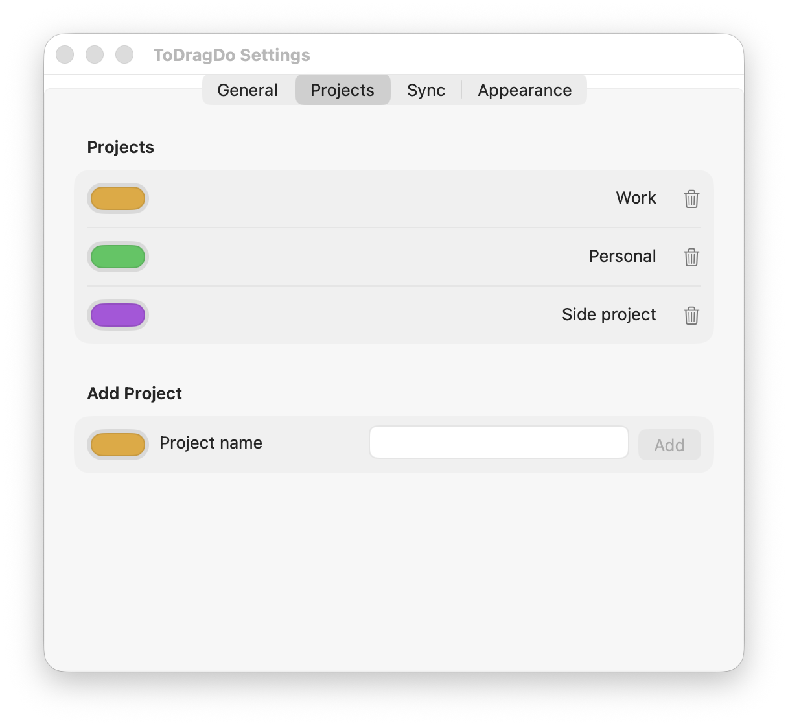
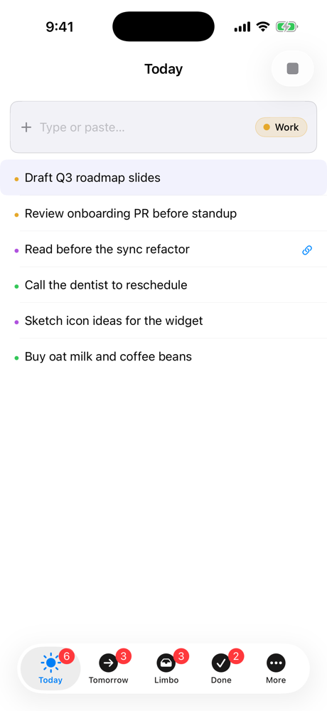
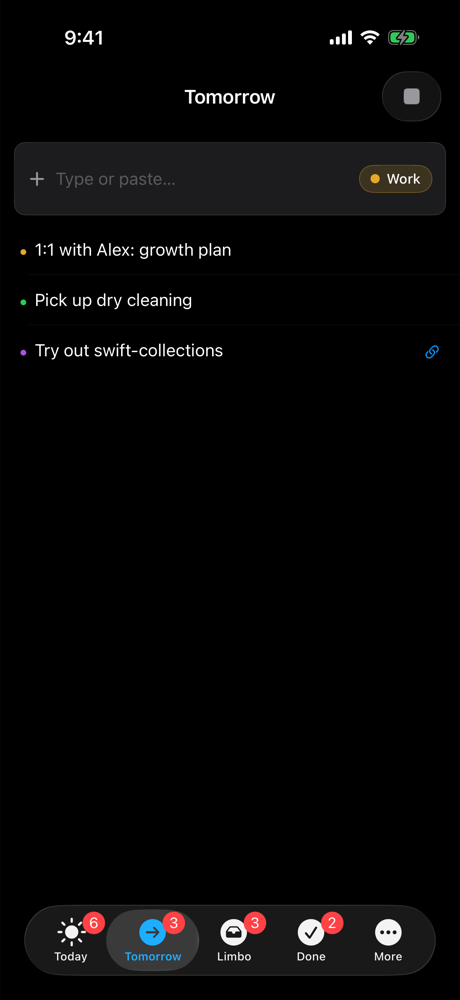

# ToDragDo

A todo list that floats on top of your Mac.

- **Always on top.** Above every app, even full-screen. Collapses to just the input bar.
- **Invisible when you share your screen.** Hidden from screen sharing, recordings and screenshots.
- **iCloud sync** across Mac, iPhone and iPad.

Also: drag-n-drop anything, Today / Tomorrow / Limbo / Done with daily rollover, projects, iPhone app and widgets.

## Screenshots

<table>
  <tr>
    <th>macOS</th>
    <td align="center"><br><sub>Panel with row actions</sub></td>
    <td align="center"><br><sub>Project filter</sub></td>
    <td align="center"><br><sub>Done summary</sub></td>
    <td align="center"><br><sub>Projects settings</sub></td>
  </tr>
  <tr>
    <th>iPhone</th>
    <td align="center"><br><sub>Today</sub></td>
    <td align="center"><br><sub>Tomorrow, dark mode</sub></td>
  </tr>
</table>

<sub>All screenshots use made-up demo data (see <a href="#demo-mode">Demo mode</a>).</sub>

## Requirements

- macOS 26.1+ / iOS 26+
- Xcode 26
- An Apple Developer team with iCloud (CloudKit) and App Groups enabled,
  to run with sync

## Project layout

```
ToDragDo/
├── ToDragDo/            macOS app (floating NSPanel, menu-bar item, Settings)
├── ToDragDo-iOS/        iPhone / iPad app
├── ToDragDoWidgets/     WidgetKit extension
└── Core/ToDragDoCore/   Swift package shared by all targets
    ├── ToDragDoCore          models, Repository, SwiftData storage, sync core
    ├── ToDragDoSync          CloudKit adapter, environments, migration
    ├── ToDragDoContentTypes  text / URL / file / image providers
    └── ToDragDoIntents       App Intents, App Group, deep links
```

## Building

Open `ToDragDo/ToDragDo.xcodeproj` and run the `ToDragDo` (macOS) or
`ToDragDo-iOS` scheme.

- **Debug** builds talk to the **Development** CloudKit environment.
- **Release** builds talk to **Production**.

```bash
./scripts/build-prod.sh
```

builds a signed macOS Release app into `Artifacts/` and checks that it
targets Production. Run the core tests with:

```bash
cd ToDragDo/Core/ToDragDoCore && swift test
```

### Demo mode

Launch either app with `-DemoMode` to get an in-memory store filled with
fake projects and items and no sync. It never touches your real data, so
it's safe for screenshots on a device that also runs the real app.

```bash
open -n ToDragDo.app --args -DemoMode
```

## Docs

- [ARCHITECTURE.md](ARCHITECTURE.md): how the app is put together
  (storage, outbox-based sync, CloudKit environments, the floating panel).
- [ReleaseInstructions.md](ReleaseInstructions.md): shipping a Production
  build, schema deploys, and the Development → Production migration.
- [REQUIREMENTS.md](REQUIREMENTS.md) and
  [REQUIREMENTS-iOS.md](REQUIREMENTS-iOS.md): product requirements.
